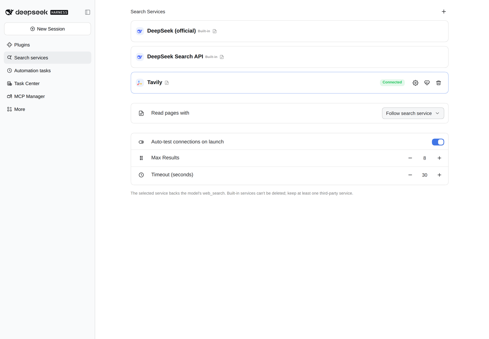
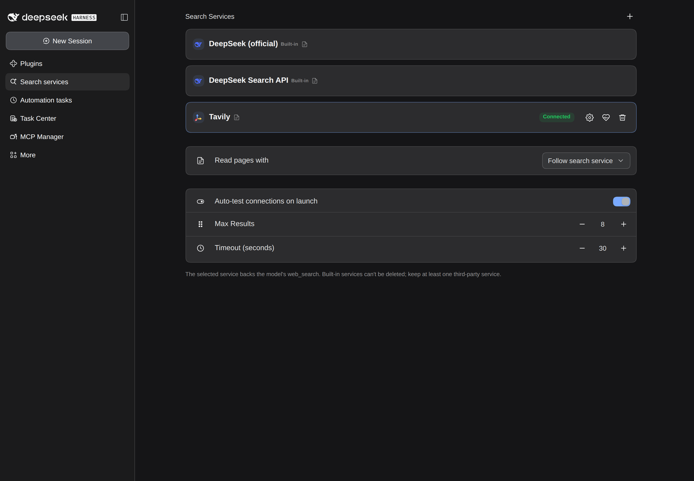
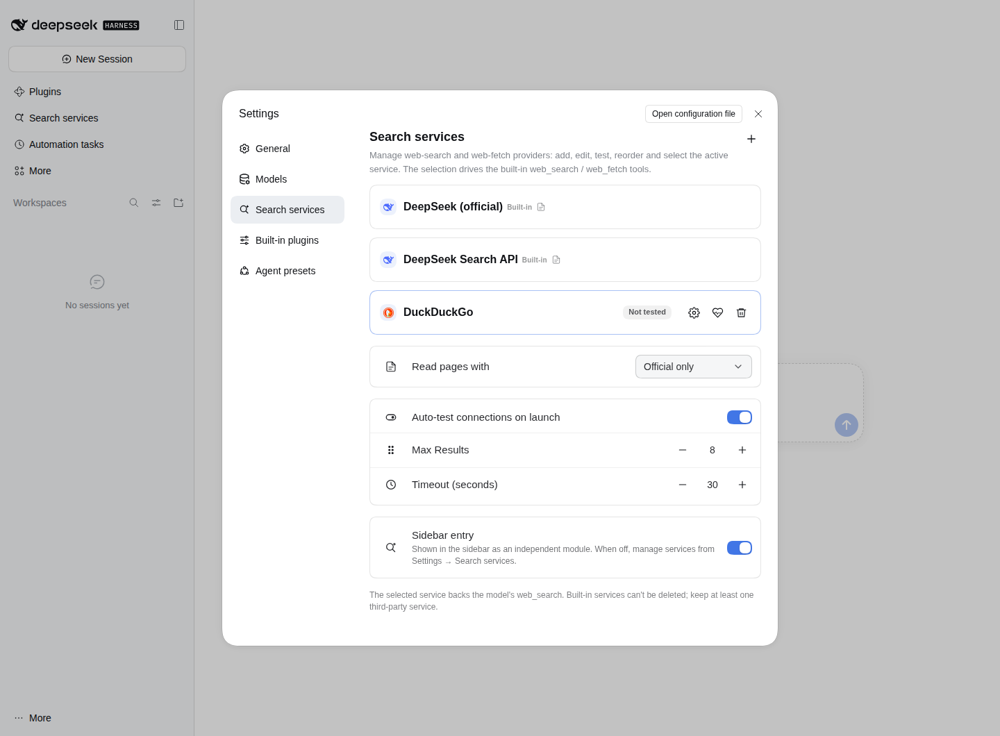
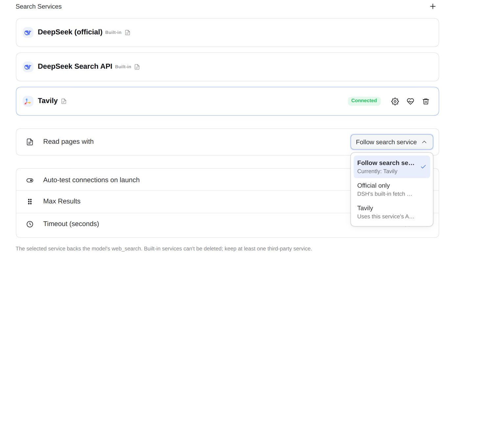
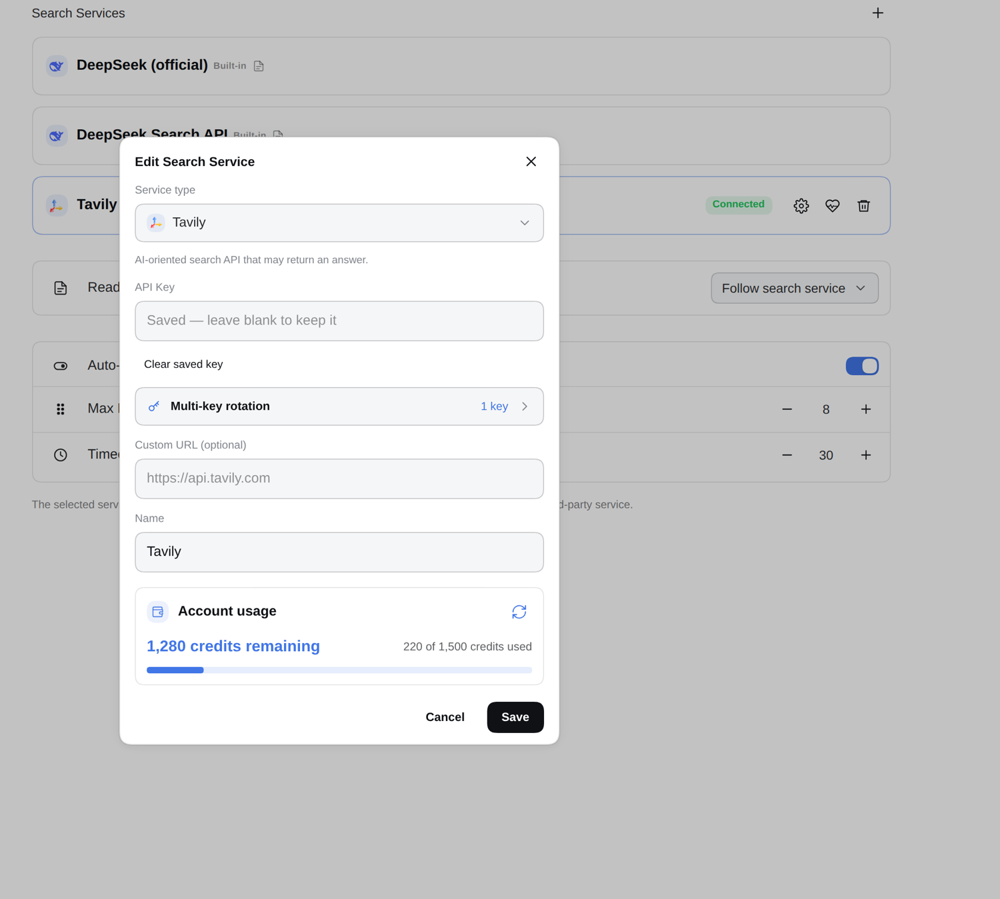
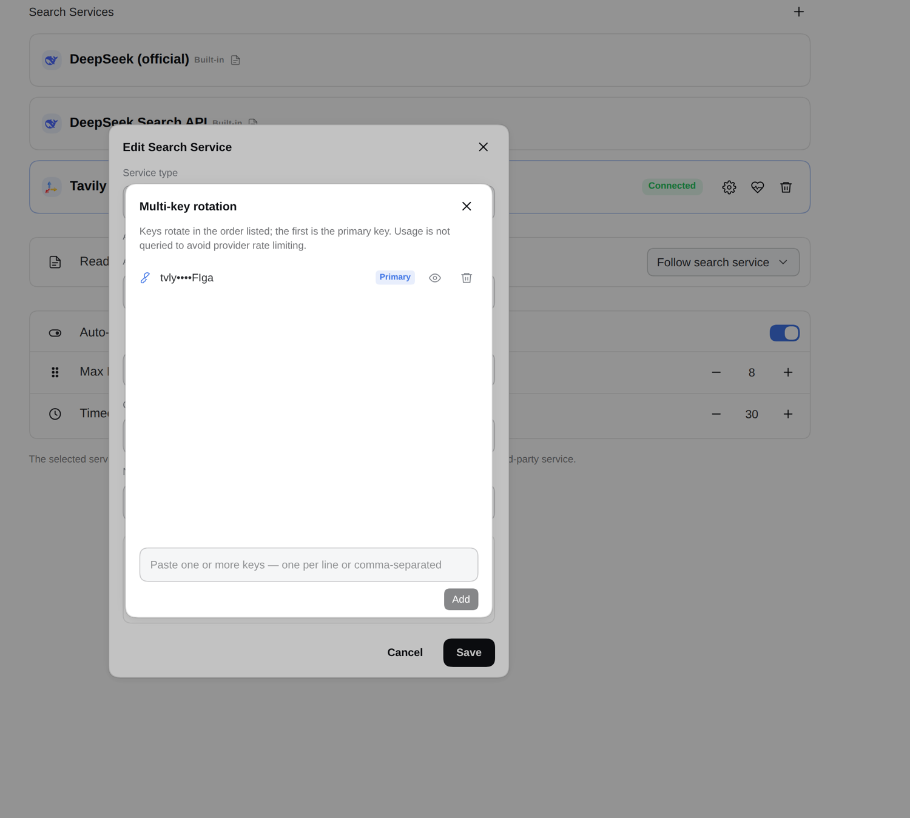
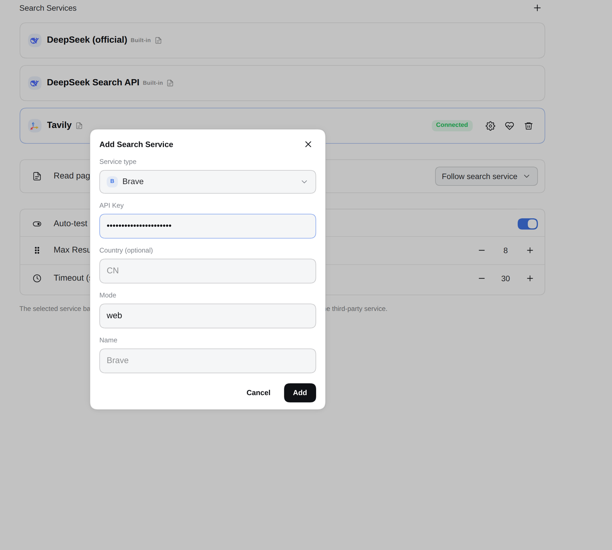

# Search services for DeepSeek Harness

**搜索服务 · manage the providers behind `web_search` and `web_fetch`, from DSH's Settings.**

A [DeepSeek Harness](https://github.com/deepseek-ai/deepseek-harness) plugin that recreates
[Kelivo](https://github.com/Chevey339/kelivo)'s *Search services* pane inside DSH — cards, live status,
multi-key pools, account balance and page-fetch routing — in the harness's own theme. The default
management entry is **Settings → Search services**; the original sidebar page ships as an independent
module that can be switched on and off from that page.

<p align="center">
  <a href="https://www.npmjs.com/package/@ds-hu/dsh-better-search"></a>
  <a href="https://github.com/ds-hu/dsh-better-search/blob/main/LICENSE"></a>
  
  <a href="https://github.com/ds-hu/dsh-better-search/blob/main/README.zh-CN.md">中文</a>
</p>

<p align="center">
  
</p>

## What it does

- **26 search providers** — Tavily, Brave, Exa, SearXNG, Perplexity, Serper, 智谱, 秘塔, 博查, 豆包,
  Kimi, Jina, LinkUp, Metaso, Ollama, DeepSeek, Kagi, Querit, Grok, StepFun, Firecrawl, TinyFish,
  AnySearch, Parallel, You.com, plus keyless Bing Local and DuckDuckGo.
- **One card per service** — add, edit, reorder, delete, test the connection with a real query, and
  click a card to make it the active provider. Built-in DeepSeek providers appear as read-only cards
  so the list always shows what is actually available.
- **Ready or not, visibly** — 已连接 / 连接失败 / 未测试 states, filled by a real one-query test that
  can also run automatically on launch.
- **Multiple keys per service** — the pool is used round-robin; keys are listed masked, can be
  revealed, deleted or pasted in batches, and the first key stays primary.
- **Account usage** — one click asks Tavily or LinkUp how much quota is left, with a progress bar.
- **Page fetching is configurable too** — pick who reads pages: follow the active search service,
  keep DSH's own fetch provider, or pin any of the 13 fetch-capable services.
- **No fighting with DSH's own settings** — change the switch on the official **网页搜索** page and the
  panel follows it (and says so) without dropping your page-fetch mode; a pin left behind by a
  removed service is healed automatically.
- **Settings first, sidebar optional** — the management page lives in **Settings → Search services**.
  The sidebar entry is a separate module with its own **Sidebar entry** switch (on by default,
  applied live): turn it off to keep the sidebar clean, and manage everything from Settings.
- **Light and dark** — follows the harness theme; no hard-coded colours.

<p align="center">
  
</p>

<p align="center">
  
</p>

## Screenshots

| | |
|---|---|
|  |  |
| **Read pages with** — follow the active search service, keep the official one, or pick a service. | **Edit dialog** — account quota, masked key field and the multi-key entry point. |
|  |  |
| **Multi-key rotation** — masked list, reveal, delete, batch paste. | **Add a provider** — pick one of 26 types; fields adapt to the provider. |

## Install

```sh
# npm
dsh plugin --profile web add @ds-hu/dsh-better-search

# or straight from the repository
dsh plugin --profile web add github:ds-hu/dsh-better-search
```

Then list the bundle in the profile's `dsh.profile.bundles` (in `$DSH_HOME/profiles/web/package.json`)
and restart `dsh web`:

```json
{ "dsh": { "profile": { "bundles": ["…", "@ds-hu/dsh-better-search"] } } }
```

## Use

1. Open **Settings** (the menu at the foot of the sidebar) → **Search services**, or click the
   **Search services** icon in the sidebar while its module is on. The settings page is the default
   entry; the sidebar page is optional and can be switched under **Sidebar entry** on the same page.
2. **+** → pick a provider → paste the key → **Add**.
3. Click the card to activate it — the built-in `web_search` tool uses it immediately, no restart.
4. ♥ tests the connection, ⚙ edits, 🗑 deletes; drag cards to reorder.
5. Open ⚙ again for the account balance, the key pool, the optional custom URL, and **Read pages
   with** for page fetching.

Stored keys are never echoed back: the dialog shows an empty key field with
“Saved — leave blank to keep it”.

## Providers

| Group | Providers |
|---|---|
| Global | Tavily, Exa, LinkUp, Perplexity, Brave, Serper, Jina, Firecrawl, TinyFish, AnySearch, Parallel, You.com, Kagi, Querit, Grok |
| Chinese | 智谱 (Zhipu), 秘塔 (Metaso), 博查 (Bocha), 豆包 (Doubao), Kimi, StepFun |
| Model vendors | DeepSeek, Ollama |
| Self-hosted | SearXNG |
| Keyless | Bing Local, DuckDuckGo |

13 of them can also read pages: Tavily, Exa, LinkUp, Metaso, Ollama, DeepSeek, Jina, Querit,
Firecrawl, TinyFish, AnySearch, Parallel, You.com.

## Uninstall & cleanup

Uninstalling while `dsh web` runs removes both management entries, the HTTP route and every dynamic
provider, and restores the profile's provider fields. Your service list, keys and the
sidebar-entry preference stay in `$DSH_HOME/better-search/` on purpose — remove them only when you
mean it:

```sh
dsh-better-search status      # what is stored (never prints keys)
dsh-better-search clean --yes # delete the store directory
```

`clean` also removes any stray `*.bak` files. If the bundle is removed while `dsh` is stopped, the
next start heals the leftover `better-search/*` pin instead of leaving searches broken.

## Docs

- [Technical notes](https://github.com/ds-hu/dsh-better-search/blob/main/docs/TECHNICAL.md) — how the plugin is put together, data model, failure modes.
- [Host ↔ panel contract](https://github.com/ds-hu/dsh-better-search/blob/main/docs/CONTRACT.md) — the JSON API and panel contract.
- [NOTICE](https://github.com/ds-hu/dsh-better-search/blob/main/NOTICE) — third-party attribution (provider logos, Kelivo porting note).

## License

MIT — see [LICENSE](https://github.com/ds-hu/dsh-better-search/blob/main/LICENSE) and [NOTICE](https://github.com/ds-hu/dsh-better-search/blob/main/NOTICE). Provider names and logos are their owners'
trademarks, used only to identify the service each card configures.
