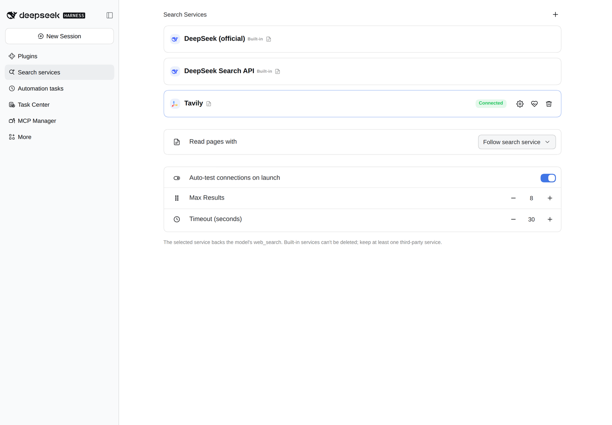
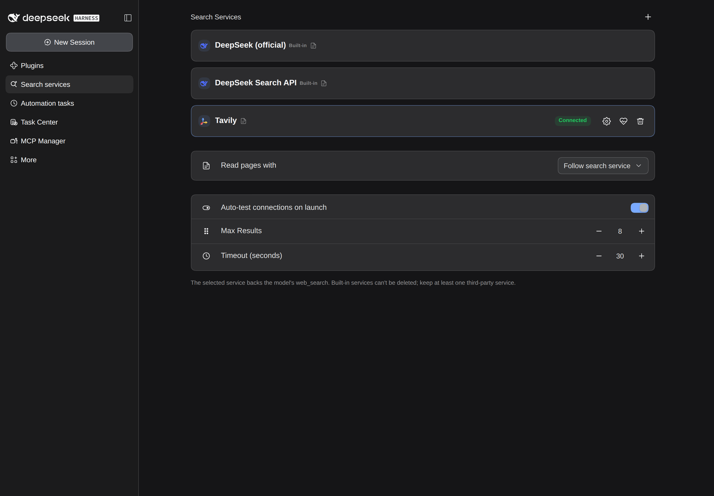
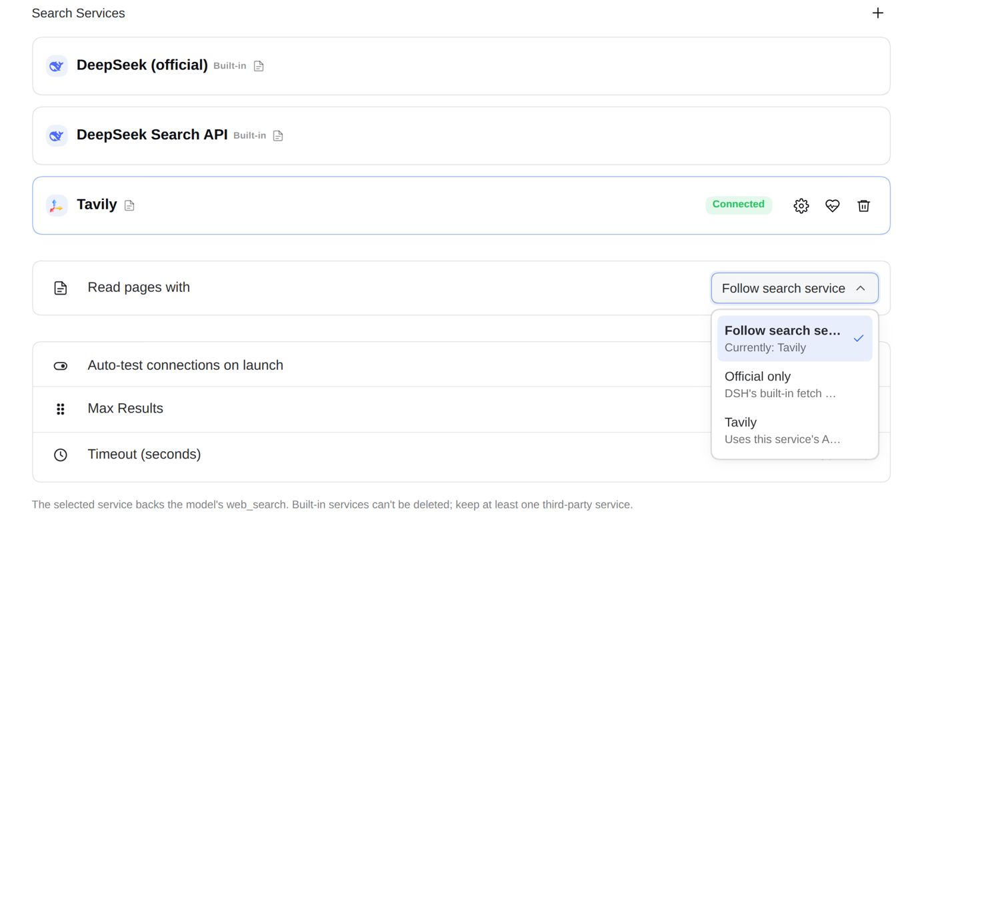
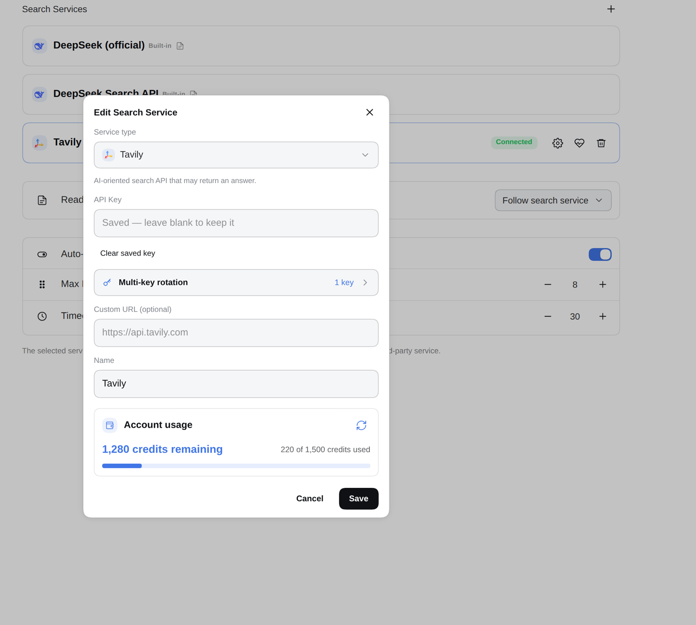
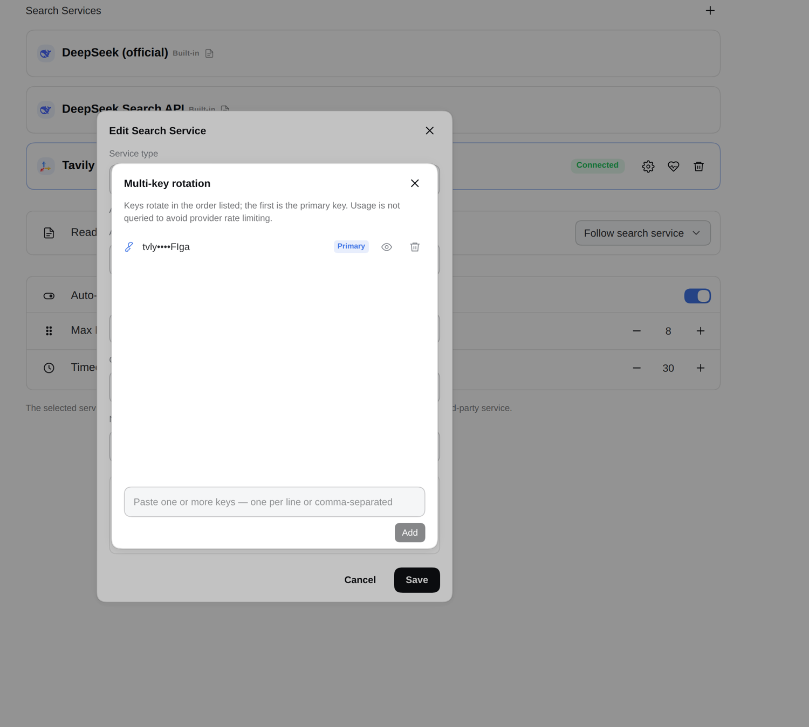
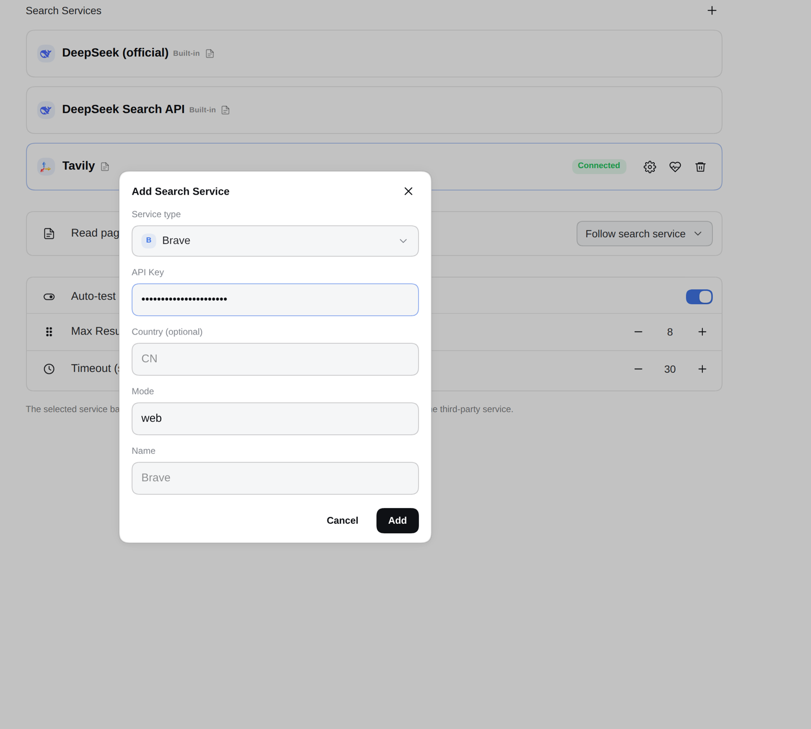

# 搜索服务 · DeepSeek Harness 插件

**搜索服务 · 在侧边栏管理 `web_search` 和 `web_fetch` 背后的服务商。**

这是一个 [DeepSeek Harness](https://github.com/deepseek-ai/deepseek-harness) 插件，把
[Kelivo](https://github.com/Chevey339/kelivo) 的「搜索服务」面板搬进 DSH：服务卡片、实时状态、
多 Key 池、账户额度、网页抓取路由，全部使用 Harness 自己的主题。

<p align="center">
  <a href="https://www.npmjs.com/package/@ds-hu/dsh-better-search"></a>
  <a href="https://github.com/ds-hu/dsh-better-search/blob/main/LICENSE"></a>
  
  <a href="https://github.com/ds-hu/dsh-better-search/blob/main/README.md">English</a>
</p>

<p align="center">
  
</p>

## 能做什么

- **26 家搜索服务商** —— Tavily、Brave、Exa、SearXNG、Perplexity、Serper、智谱、秘塔、博查、豆包、
  Kimi、Jina、LinkUp、Metaso、Ollama、DeepSeek、Kagi、Querit、Grok、StepFun、Firecrawl、
  TinyFish、AnySearch、Parallel、You.com，以及免 Key 的 Bing Local、DuckDuckGo。
- **一家服务一张卡片** —— 添加、编辑、排序、删除、用真实查询测试连接；点一下卡片就把它设为当前
  生效的服务。内置的 DeepSeek 服务以只读卡片呈现，列表始终反映实际可用的服务商。
- **状态一眼可见** —— 已连接 / 连接失败 / 未测试，由一次真实查询测试得出，也可以设置启动时自动测试。
- **一个服务多个 Key** —— 池内轮询使用；Key 以掩码列出，可以逐条查看、删除、批量粘贴，第一个
  始终是主 Key。
- **账户额度** —— 一键向 Tavily 或 LinkUp 查询剩余额度，Tavily 带进度条。
- **网页抓取也能选服务商** —— 跟随当前搜索服务、保留 DSH 官方提供方，或指定 13 家支持抓取的
  服务商之一。
- **不和官方设置打架** —— 在官方「网页搜索」页拨开关时，面板会自动跟随并给出提示；服务被删除后
  残留的选择会被自动修复。
- **浅色 / 深色** —— 跟随 Harness 主题，没有写死的颜色。

<p align="center">
  
</p>

## 截图

| | |
|---|---|
|  |  |
| **抓取方式** —— 跟随当前搜索服务、保留官方提供方，或指定某个服务商。 | **编辑弹层** —— 账户额度、掩码 Key 字段，以及多 Key 入口。 |
|  |  |
| **多 Key 轮询** —— 掩码列表、查看、删除、批量粘贴。 | **添加服务商** —— 26 种类型任选，字段随服务商变化。 |

## 安装

```sh
# npm
dsh plugin --profile web add @ds-hu/dsh-better-search

# 或者直接从仓库安装
dsh plugin --profile web add github:ds-hu/dsh-better-search
```

然后把 bundle 加进该 profile 的 `dsh.profile.bundles`（`$DSH_HOME/profiles/web/package.json`），
重启 `dsh web`：

```json
{ "dsh": { "profile": { "bundles": ["…", "@ds-hu/dsh-better-search"] } } }
```

## 使用

1. 侧边栏打开 **搜索服务**（位于「插件」与「自动化任务」之间）。
2. **+** → 选服务商 → 粘贴 Key → **添加**。
3. 点卡片启用它 —— 内置的 `web_search` 立刻改用这家服务，无需重启。
4. ♥ 测试连接、⚙ 编辑、🗑 删除；拖动卡片调整顺序。
5. 再打开 ⚙ 可以看账户额度、管理 Key 池、填自定义 URL；**抓取方式** 决定 `web_fetch` 由谁执行。

已保存的 Key 不会回显：编辑弹层里 Key 输入框是空的，占位提示「已保存，留空则不修改」。

## 服务商

| 分组 | 服务商 |
|---|---|
| 通用 | Tavily、Exa、LinkUp、Perplexity、Brave、Serper、Jina、Firecrawl、TinyFish、AnySearch、Parallel、You.com、Kagi、Querit、Grok |
| 国内 | 智谱、秘塔、博查、豆包、Kimi、StepFun |
| 模型厂商 | DeepSeek、Ollama |
| 自建 | SearXNG |
| 免 Key | Bing Local、DuckDuckGo |

其中 13 家同时支持网页抓取：Tavily、Exa、LinkUp、Metaso、Ollama、DeepSeek、Jina、Querit、
Firecrawl、TinyFish、AnySearch、Parallel、You.com。

## 卸载与清理

在 `dsh web` 运行中卸载：面板、HTTP 路由、所有动态 provider 都会被移除，profile 里的两个
服务商字段会恢复原值。服务列表和 Key 仍会留在 `$DSH_HOME/better-search/`（这是有意的），需要时再清：

```sh
dsh-better-search status      # 查看存了什么（不会打印 Key）
dsh-better-search clean --yes # 删除整个存储目录
```

`clean` 也会一并清掉遗留的 `*.bak` 文件。如果 dsh 停止运行时删掉了 bundle，下次启动会自动修复
残留的 `better-search/*` 选择，不会让搜索一直报错。

## 文档

- [技术说明](https://github.com/ds-hu/dsh-better-search/blob/main/docs/TECHNICAL.md) —— 插件结构、数据模型、失败模式。
- [Host ↔ 面板契约](https://github.com/ds-hu/dsh-better-search/blob/main/docs/CONTRACT.md) —— JSON API 与面板契约。
- [NOTICE](https://github.com/ds-hu/dsh-better-search/blob/main/NOTICE) —— 第三方归属（服务商 Logo、Kelivo 移植说明）。

## 许可

MIT —— 见 [LICENSE](https://github.com/ds-hu/dsh-better-search/blob/main/LICENSE) 与 [NOTICE](https://github.com/ds-hu/dsh-better-search/blob/main/NOTICE)。各家服务商名称与 Logo 是其所有者的商标，
仅用于标识对应服务。
